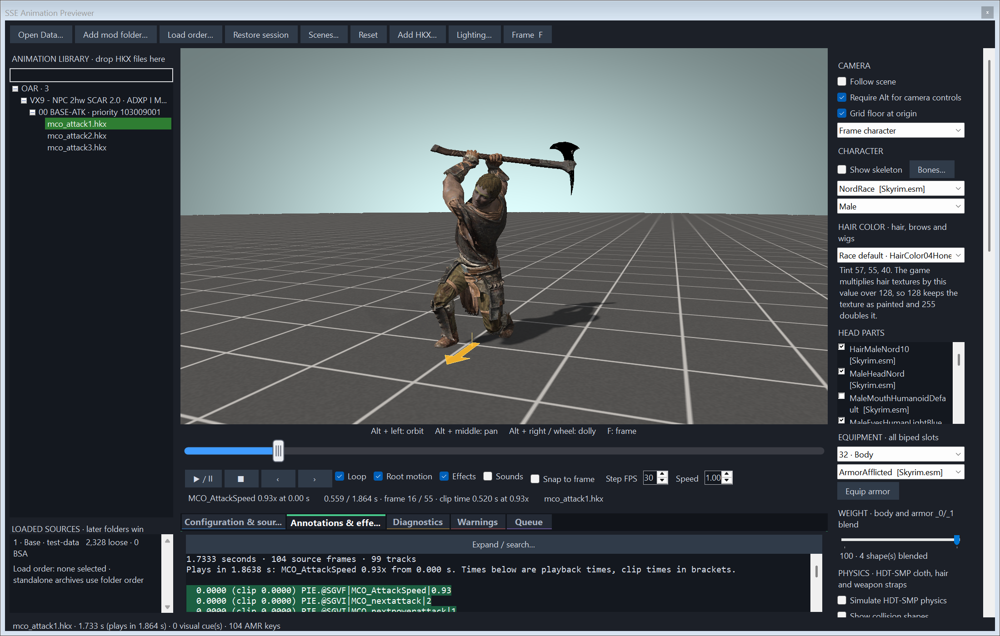
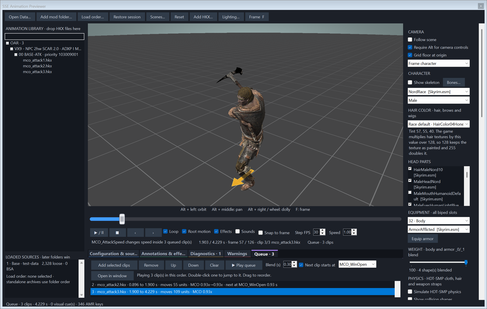
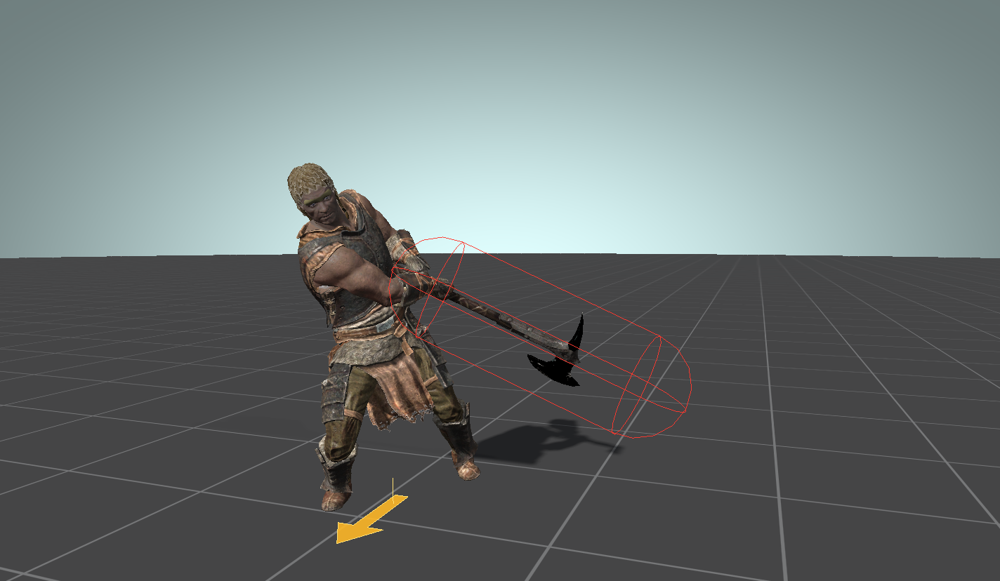
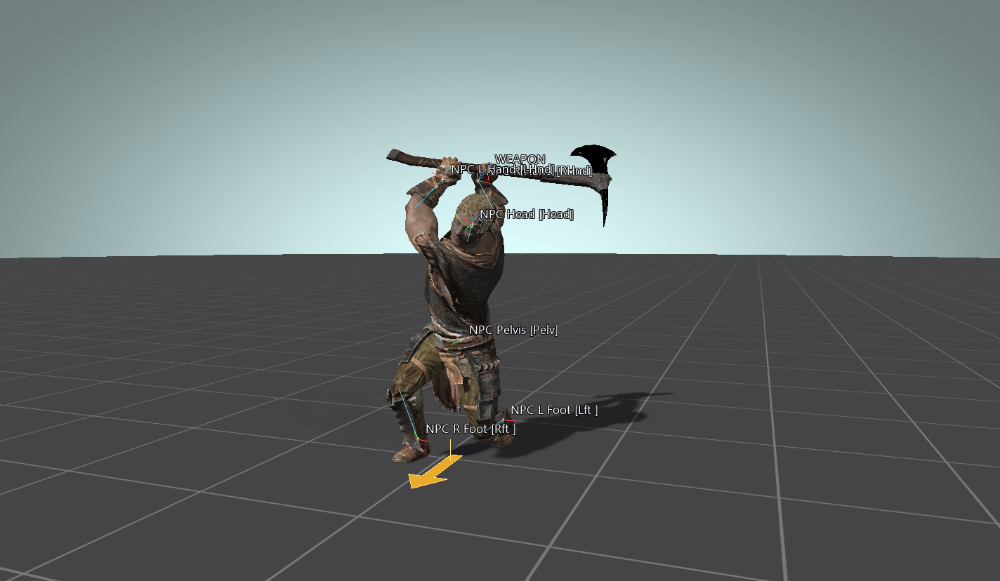
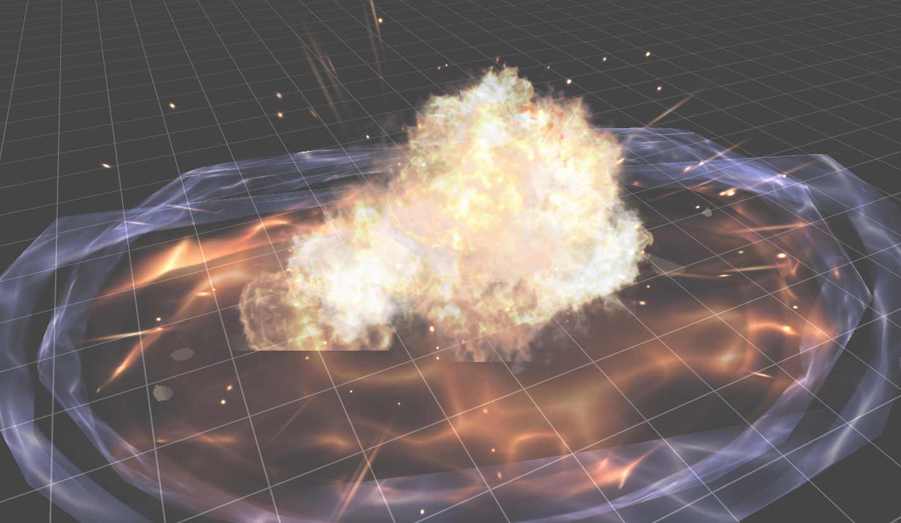

# SSE Animation Previewer

A standalone Windows program that plays Skyrim Special Edition animations on a real character, with the armor, weapon, effects and physics you choose, without starting the game.

It reads your Data folder and mod folders directly. Point it at a moveset, pick a clip, and you see the pose, the root motion, every annotation, the Precision hit capsules and the HDT-SMP cloth, all on one timeline you can scrub frame by frame.



It is a development preview. Animation playback, annotations and the overlays follow the clip's data and the source of the mods they imitate. Character rendering and particle effects are close but have not been matched against the game image by image. [Known limits](#known-limits) lists what is approximate.

## Download

Get the latest zip from [Releases](https://github.com/DCCStudios/SSE-Animation-Previewer/releases), unpack it anywhere and run `SSE Animation Previewer.exe`. Keep the folder together. It carries its own .NET runtime and C++ runtime, so nothing else needs installing.

You need Windows 10 or 11 (x64), a graphics card and driver with OpenGL 4.3, and a Skyrim SE or AE Data folder. The program ships no game assets.

## Quick start

1. **Open Data…** and choose your Skyrim `Data` folder.
2. **Add mod folder…** for each mod you want on top. Later folders win.
3. **Load order…** and pick your `plugins.txt` if the install is modded.
4. Choose a race, armor and weapon in the right column.
5. Click a clip in the animation library, or drag `.hkx` files or folders onto it.

[Getting started](docs/getting-started.md) covers Mod Organizer 2, sessions and saved scenes.

## Features

| | |
|---|---|
| **[Playback and timeline](docs/playback.md)** | Scrub, step by frame, loop, change speed. Root motion from AMR annotations moves the actor, with an arrow marking the root and a camera that travels with it. |
| **[Animation queue](docs/animation-queue.md)** | Chain clips into a combo on one timeline. Each clip hands over at `MCO_WinOpen` or `MCO_PowerWinOpen`, blends in, and carries root motion and attack speed forward. |
| **[Annotations](docs/annotations.md)** | Every annotation with its time. The ones active right now are highlighted as the clip plays. `MCO_AttackSpeed` changes are applied the way MCO applies them. |
| **[Animation library and overrides](docs/animation-library.md)** | OAR and DAR folders shown by mod, submod and priority, with conditions written out. The playing clip turns orange when a higher-priority folder holds the same file, and hovering lists those folders. |
| **[Character and equipment](docs/character-and-equipment.md)** | Any race from the loaded plugins, head parts, hair colour, body weight, armor by slot, weapon in hand or sheathed, and a bone overlay with names. |
| **[Precision attack collisions](docs/precision-collisions.md)** | The capsules Precision builds from `Collision_*` annotations, sized and timed by the rules in the Precision source. |
| **[HDT-SMP physics](docs/hdt-smp-physics.md)** | Cloth, hair and weapon straps simulated from their physics XML with Bullet, the engine FSMP uses, plus collider and constraint overlays. |
| **[Effects](docs/effects.md)** | Payload Interpreter annotations, spell and projectile art, impacts, plugin visual effects and direct NIF preview, with a particle simulator for `NiParticleSystem`. |
| **[Sounds](docs/playback.md#sounds)** | `SoundPlay.<EditorID>` annotations resolved through the plugin's sound records and played at their volume and pitch. |
| **[Command line](docs/command-line.md)** | An off-screen mode and built-in checks for scripted runs. |

### A combo on one timeline

Queue three attacks and the previewer chains them the way a combo does. It cuts each one at its combo window, blends it into the next, and moves the actor as far as the root motion adds up to.



### Where the hit lands

Tick **Show Precision attack collisions** and the attack capsule appears for exactly as long as the annotations keep it alive.



### What is in the skeleton

The bone overlay draws every bone, or only the ones you tick, with names and local axes.



### Effects without the game

Open any effect NIF and scrub through it.



## Controls

| Input | Action |
|---|---|
| Alt + left drag | Orbit |
| Alt + middle drag | Pan |
| Alt + right drag, or wheel | Zoom |
| F, with the viewport focused | Frame the scene |
| Space | Play or pause |
| Left, Right on the timeline | Nudge by half a percent |

Untick **Require Alt for camera controls** to use plain drags. The camera zooms to within 2 units of its focus point, so pan the focus onto a face or a hand before zooming in on it.

## Known limits

- The previewer does not run behavior graphs. A clip plays as a clip. Transitions in the queue use your blend time, not the graph's.
- The previewer shows OAR and DAR conditions and never evaluates them. It cannot tell you which submod wins for a given actor, only which ones can.
- Particle systems run a deterministic simulation of the NIF's modifiers. Emitters, forces, colliders and flipbooks are covered; some modifiers and shader effects are approximate, and the Diagnostics tab names every block it could not handle.
- The previewer does not execute gameplay scripts, hit detection or actor conditions.
- Race morphs, alternate texture sets on armor and partial partition hiding are incomplete.
- HDT-SMP uses the same solver and XML rules as FSMP, but it has not been compared with the game frame by frame.

[Technical notes](docs/technical-notes.md) has the full list, with what was verified and how.

## Building from source

The repository is self-contained. Install the .NET 8 SDK or a later one, then:

```
git clone https://github.com/DCCStudios/SSE-Animation-Previewer
cd SSE-Animation-Previewer
dotnet build -c Release
```

The renderer and file readers the program is built on are included as source under `engine`, so there is nothing else to fetch or build first. [Building](docs/building.md) covers the layout, the portable package and the tests.

## License and credits

The application source is GPL-3.0-or-later. See [LICENSE](LICENSE).

It stands on other people's work: MANOLOV02's FO4_Base_Library, NiflySharp fork and BSA/BA2 library, ousnius's Material Editor, Microsoft's DirectXTex, Bullet and BulletSharp, OpenTK and NAudio. The HDT-SMP reader and collision code follow the FSMP (hdtSMP64) source, and the refraction shaders adapt equations from Community Shaders. [THIRD-PARTY-NOTICES.md](THIRD-PARTY-NOTICES.md) and the `licenses` folder have the details.

Skyrim and its assets belong to Bethesda Softworks. The screenshots show a vanilla character, armor, weapon and effect loaded from a local installation. The attack clips in them come from a third-party battleaxe moveset, whose name appears in the library panel.
