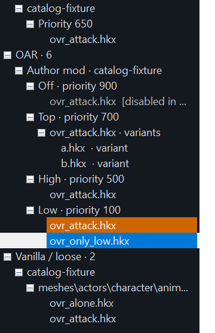

# Animation library and overrides

[Back to the README](../README.md)

The library on the left lists every animation in the mounted folders, grouped the way the replacer frameworks see them.

- **OAR** clips sit under their mod, then their submod with its priority. Submods are sorted highest priority first.
- **DAR** clips sit under their `_CustomConditions` priority folder, or their plugin and actor folder.
- **Vanilla / loose** holds plain files in the normal animation folders.
- **Dropped** holds files you dragged in from elsewhere.

Type in the box above the tree to filter. Every word must match somewhere in the path, mod name, submod name or configuration.

A clip from an OAR variants folder shows which file it stands in for and its weight. A clip disabled in its OAR configuration is greyed and marked, and can still be previewed.

## Reading a submod's configuration

Select a clip or a submod and open **Configuration & source**. It shows the author's `config.json` and any `user.json` separately, since OAR lets the user file replace the author's settings. Conditions are written as an indented outline with groups, negation and disabled state kept.

The outline is for reading. The previewer does not evaluate conditions, so it cannot say whether a submod applies to a particular actor.

Submods that borrow another folder through `overrideAnimationsFolder` are listed with the clips they borrow, under their own priority and conditions.

## Which clip is playing, and can it be overridden

The row of the clip that is playing is green, wherever the tree selection is.

It is orange when another enabled OAR or DAR folder with a higher priority holds the same animation file. That folder can replace the clip in game.

Hover any clip to see the folders that override it, highest priority first, each with its mod, submod and path. The tooltip shows the first eight. **Configuration & source** lists all of them for the playing clip.

How the comparison works:

- Two clips compete when they stand in for the same game file. `mco_attack1.hkx` in one submod competes with `mco_attack1.hkx` in another, but not with `male\mco_attack1.hkx`.
- A `_variants_` folder counts for the file it replaces.
- A plain file counts every enabled replacer folder that holds it, at any priority.
- Disabled submods are left out. So are the clip's own submod and submods at an equal priority.

Orange means the clip can lose. Since conditions are not evaluated, it does not mean the clip does lose. If the higher folder's conditions never pass for your character, your clip still plays.

### Typical use

You add a moveset and your attack does not show up in game. Select the clip. If its row is orange, hover it, and the tooltip names the submods with a higher priority that carry the same file. Raise your priority above them or check their conditions.
