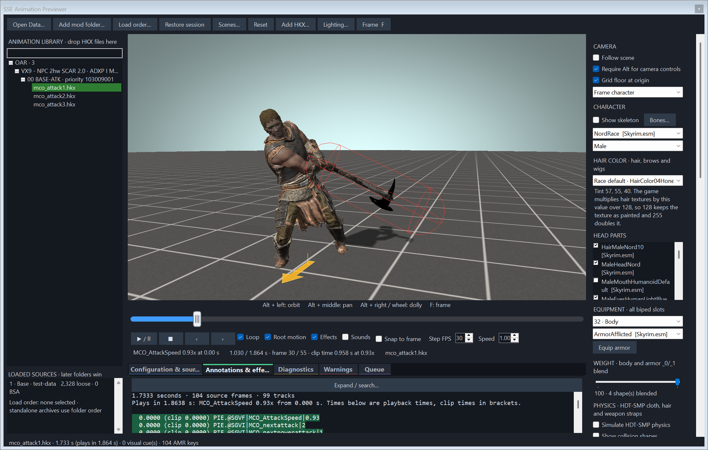

# Annotations

[Back to the README](../README.md)

The **Annotations & effects** tab lists every annotation in the clip with its time. Under the list come the weapon draw schedule, the Precision collision timeline, the sounds with what they resolved to, and the visual effects the annotations produced.

When a clip changes speed, each line shows the playback time first and the clip time in brackets.

## Active annotations

The annotations that are in effect at the current time are highlighted in green. The highlight moves as the clip plays, and the list scrolls to keep the latest one in view. When paused it stays where you put it.

An ordinary annotation is active from when it fires until the next annotation fires. Annotations at the same time are active together. Some last longer, because they describe a state and not a moment.

| Annotation | Active until |
|---|---|
| `MCO_nextattack`, `MCO_nextpowerattack` | The next one of the same kind |
| `MCO_WinOpen`, `MCO_PowerWinOpen` | The matching `WinClose` |
| `MCO_WinClose`, `MCO_PowerWinClose` | The next matching open |
| `MCO_AttackSpeed` | The next `MCO_AttackSpeed` |
| `Collision_Add` | Precision removes that collision |
| `Collision_AttackStart` | The attack ends (`Collision_AttackEnd`, `Collision_Cancel`, `attackStop`, `staggerStart`) |
| Other `Collision_` annotations | The next `Collision_` annotation |

BFCO's annotations have their own rules: the next-attack annotations and both windows last until `BFCO_DIY_EndLoop`, and a BFCO clip gets a notes section with the next clip and warnings. See [BFCO clips](bfco.md).

AMR `animmotion` and `animrotation` keys sit on almost every frame, so they never end another annotation. The latest key of each is highlighted.

In a queue, annotations after a clip's hand-over never fire and are never highlighted.

## Common uses

**Check a combo window.** Scrub until `MCO_WinOpen` lights up and look at the pose. That is the earliest frame the next attack can start from.

**Check hit timing.** Tick **Show Precision attack collisions** and step frame by frame. The `Collision_Add` line is green for exactly the frames the capsule exists. See [Precision attack collisions](precision-collisions.md).

**Find a speed change.** The `MCO_AttackSpeed` line that is green is the one in force.

## Searching

**Expand / search…** at the top of the Configuration, Annotations, Diagnostics and Warnings tabs opens the text in a larger window with a search box, Find next and a line-wrap toggle.
