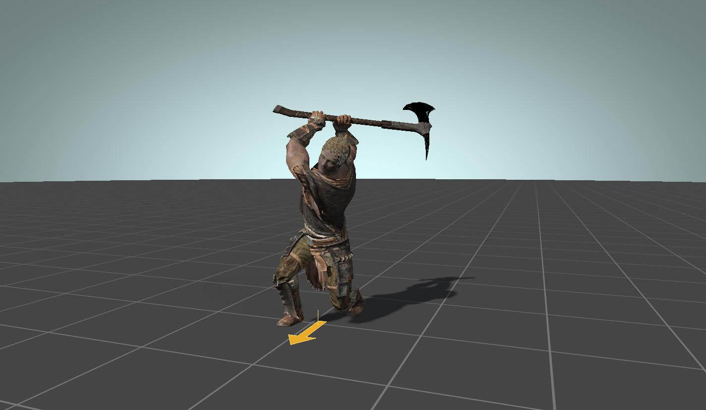
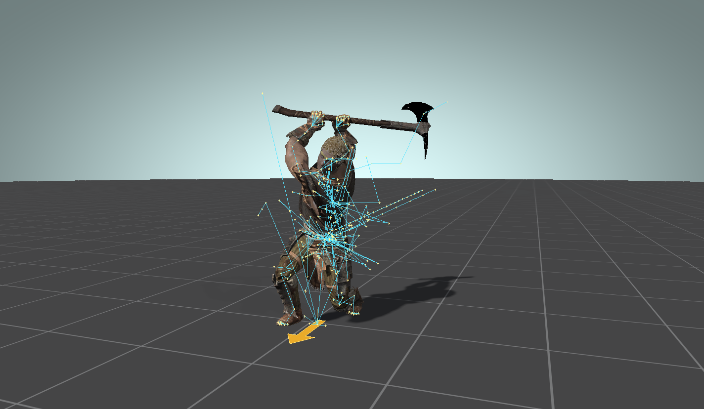

# Character and equipment

[Back to the README](../README.md)

The right column builds the actor the clip plays on. It reads the same records the game does, so a custom race or an armor mod works once its folder and plugin are mounted.

## Race, sex and head

**CHARACTER** lists every playable race in the loaded plugins. Choosing one loads its skeleton, body, default head parts and skin tint for the selected sex.

**HEAD PARTS** lists the race's hair, head, mouth, eyes and brows. Tick or untick parts to swap them.

**Hair color** sets the one hair colour the actor carries. The game writes that colour into every hair-tint material on the actor, so it reaches hair, brows and worn hair-tint pieces such as wigs. "Race default" uses the race's own default. The list also holds every colour record in the mounted plugins and a custom picker.

The game multiplies the hair texture by the colour's bytes over 128. A value of 128 leaves the texture as painted. Vanilla colours are darker than that, and a RaceMenu colour above 128 brightens it. The previewer cannot read the colour stored in a save, so pick the one your character uses.

## Weight

The **Weight** slider (0 to 100) blends the body and every equipped armor piece between their `_0` and `_1` meshes, as the game does for actor weight. The label under it says how many shapes are blended. A mesh whose counterpart is missing or has a different vertex count stays as loaded and gets a line in Diagnostics.

## Equipment

Pick a slot, pick an armor, press **Equip armor**. A new piece replaces whatever shared its slots. The equipped list below shows what is worn.

- The slot list starts with **All slots**, which lists every armor in the loaded plugins.
- Slots 44 to 60 show their conventional use in brackets, for example "45 (neck: cape, scarf, shawl)".
- A filter typed in the armor list stays when you switch slots.
- Equipment that covers slot 31, such as a helmet or wig, replaces the hair, as in game.

Bones that exist only in an armor or head-part NIF, such as cloth chains and hair strands, are merged into the skeleton under the matching parent. That is what the game does when it attaches the item.

## Weapon

**WEAPON** lists the weapons in the loaded plugins. The chosen weapon goes on the hand bone, or on its holster node when **Sheathed on holster node** is ticked. **Show weapon** hides the mesh without removing it, which keeps weapon-attached effects working.

**Add mesh…** attaches an arbitrary NIF, and **Skeleton NIF…** replaces the skeleton.

## Skeleton overlay

**Show skeleton**, above the race list, draws every bone as a yellow joint with a cyan line to its parent, at the current pose, over the meshes.

**Bones…** opens a small window with the bone list.

- **Show bone names** labels each joint.
- Tick one or more bones to show only those. Each ticked bone also gets its local axes (X red, Y green, Z blue).
- The search box narrows the list. **Tick listed** and **Untick listed** apply to what it shows.
- **Show all** clears the selection.

### Typical use

A weapon sits at the wrong angle in one clip. Tick `WEAPON` and `NPC R Hand [RHnd]`, turn on names, and scrub. You see at once whether the `WEAPON` bone is animated on its own or is only riding the hand.

## Lighting

**Lighting…** opens the light rig: key, two fills and a back light, ambient colour, and the render options. Settings are saved with the session.
