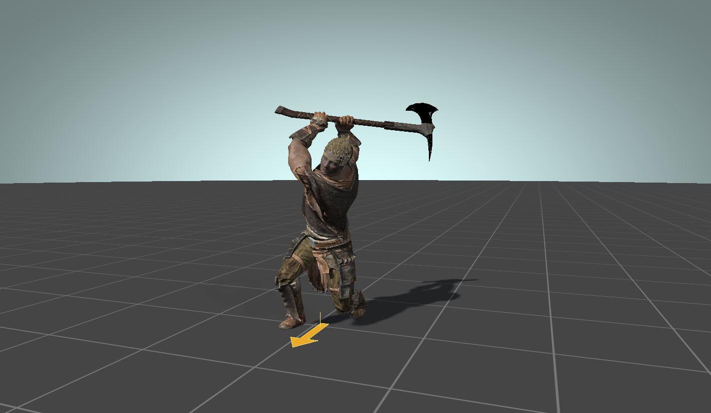
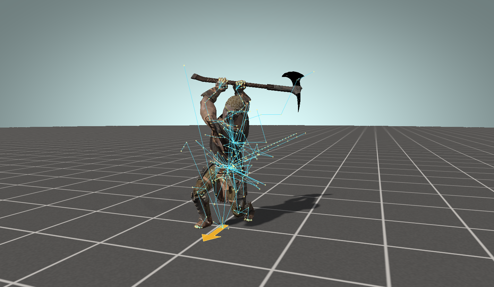
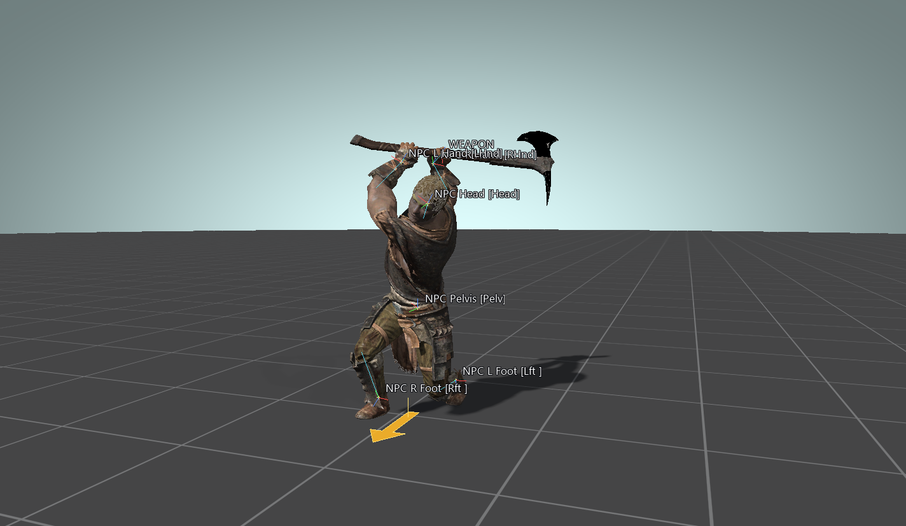

# Character and equipment

[Back to the README](../README.md)

The right column builds the actor the clip plays on. It reads the same records the game does, so a custom race or an armor mod works once its folder and plugin are mounted.

## Race, sex and head

**CHARACTER** lists every race record in the loaded plugins, creatures included. Choosing one loads its skeleton, body, default head parts and skin tint for the selected sex. The skin tint is the race's default skin tone, and the face gets the race's default tint layers.

A clip only fits the skeleton it was made for, because its tracks are numbered against that skeleton. Picking a clip from another actor folder, such as `meshes\actors\werewolfbeast` or `meshes\actors\bear`, switches to a race that animates in that folder (WerewolfBeastRace, a bear race, WolfRace for a clip with "wolf" in its name). A race's folder is the one its behavior graph is in, so a follower race with its own skeleton elsewhere, such as a custom Cloud race, still counts as a character race and keeps playing character clips. Picking a character clip afterwards switches back to the race you had. The status bar names the switch. When no loaded plugin has such a race, as with vampire lord clips when Dawnguard.esm is not mounted, the clip plays on that folder's `character assets\skeleton.nif` with the body NIF named after the folder (`vampirelord.nif`) and without the race's armor, head or weapon. A skeleton chosen with **Skeleton NIF…** is never replaced. Choosing a race by hand while a clip from another actor folder is loaded (a vampire race with a werewolf clip) leaves the character in its rest pose with a note in the status bar, instead of driving the wrong bones.

### An NPC's own looks

The list under the sex list holds every NPC record in the loaded plugins. Choosing one fills the character controls from the record, as the game resolves it:

- race, sex and weight
- the head parts the game builds: the record's own parts with their extra parts, then the race defaults for every part type the record leaves open
- hair colour, and the skin colour the record stores (`QNAM`), which goes to every skin shape of the body, the head and worn armor
- the default outfit, without a shield

An NPC that takes its traits from a template gets them from the template, as in game. When the template is a levelled list, the first entry is used and a note in Diagnostics says so.

**Use the NPC's baked head (FaceGeom)** draws the head file the game loads for that NPC, with its sculpted shape and its baked face tint (war paint, lip and eye colour, skin tone). The game names these files after the plugin that first defines the NPC, so a replacer that ships a new head under `facegeom\Skyrim.esm\` is picked up when its folder is mounted. The line under the box shows which file is used.

The previewer falls back to building the head from parts when the game would: the file is missing, or it has no shape named after one of the record's own head parts. In game that NPC gets the dark face bug. Here the face tint is composed from the record's tint layers with the game's own formula, so the colours are the ones the Creation Kit would bake, and Diagnostics names the reason. Untick the box to see that version for any NPC. A head built from parts has the race's default shape, because the record's face morphs are not applied.

Changing the race or the sex by hand drops the NPC and goes back to the race's own looks. Every other control stays editable.

Not read: SkyPatcher and similar plugins change looks at run time from their own files, and the player's look lives in the save. An NPC's height is shown but not applied.

**HEAD PARTS** lists the race's hair, head, mouth, eyes and brows. Tick or untick parts to swap them.

**Hair color** sets the one hair colour the actor carries. The game writes that colour into every hair-tint material on the actor, so it reaches hair, brows and worn hair-tint pieces such as wigs. "Race default" uses the race's own default. The list also holds every colour record in the mounted plugins and a custom picker.

The game multiplies the hair texture by the colour's bytes over 128. A value of 128 leaves the texture as painted. Vanilla colours are darker than that, and a RaceMenu colour above 128 brightens it. The previewer cannot read the colour stored in a save, so pick the one your character uses.

## Paired animations

Killmoves, hugs, mounting and other paired clips hold two actors in one file. Skyrim tells them apart by track name: one actor's tracks carry its bone names and the other's carry the same names after `2_`. Two more tracks, `NPC` and `2_`, say where each actor stands. Selecting such a clip shows both actors, bound and placed the way the game does it.

The clips in `meshes\actors\sharedkillmoves` (a human with a bear, dragon, horse and so on) are listed in the library with the rest.

**PAIRED ANIMATION** in the right column controls the second actor:

- **Show the second actor of a paired clip** draws it as a plain body of the partner race: the race's skin and default head, without equipment.
- The partner race list starts on "chosen from the clip": the loaded race whose skeleton has the most of the bones the clip animates for that role. A human pair gets the actor's own race, and `human&bear` gets a bear. Pick another race when the choice is wrong.
- **Partner: male / female** picks the body.
- **Swap roles** makes the scene's actor play the other actor's tracks. The role is otherwise the one that fits the actor's skeleton best, so a werewolf actor takes the werewolf's side of a werewolf killmove. For two humans the scene's actor plays the plain names (the attacker in a killmove), and this box gives the victim's side.

The line under the controls names each role, how many bones the clip drives on each skeleton, and the two placements.

Paired clips carry no root motion. The actors stay on their marks and the root bones move inside the clip, so **Root motion** changes nothing for them.

Not shown: the events of a paired clip (kill, end of the pairing, sounds) are stored in the behavior graphs and not in the clip, so the annotation list of a paired clip is nearly empty. The partner has no weapon, armor, physics or NPC looks.

## Weight

The **Weight** slider (0 to 100) blends the body and every equipped armor piece between their `_0` and `_1` meshes, as the game does for actor weight. The label under it says how many shapes are blended. A mesh whose counterpart is missing or has a different vertex count stays as loaded and gets a line in Diagnostics.

## Equipment

Pick a slot, pick an armor, press **Equip armor**. A new piece replaces whatever shared its slots. The **WORN ITEMS** list further down the column shows what is worn, and **Remove selected** under it takes a piece off.

- The slot list starts with **All slots**, which lists every armor in the loaded plugins.
- Unnamed slots from 44 to 60 show their conventional use in brackets, for example "45 · (neck: cape, scarf, shawl, neck-tie)".
- A filter typed in the armor list stays when you switch slots.
- Equipment that covers slot 31, such as a helmet or wig, replaces the hair, as in game.

Bones that exist only in an armor or head-part NIF, such as cloth chains and hair strands, are merged into the skeleton under the matching parent. That is what the game does when it attaches the item.

## Weapon

**WEAPON** lists the weapons in the loaded plugins. The chosen weapon goes on the hand bone, or on its holster node when **Sheathed on holster node** is ticked. **Show weapon** hides the mesh without removing it, which keeps weapon-attached effects working.

**Add mesh…** attaches an arbitrary NIF, and **Skeleton NIF…** replaces the skeleton.

## Skeleton overlay

**Show skeleton**, above the race list, draws every bone as a yellow joint with a cyan line to its parent, at the current pose, over the meshes.

**Bones…** opens a small window with the bone list.

- **Show bone names** labels each joint.
- Tick one or more bones to show only those. Each ticked bone also gets its local axes (X red, Y green, Z blue).
- The search box narrows the list. **Tick listed** and **Untick listed** apply to what it shows.
- **Show all** clears the selection.

### Typical use

A weapon sits at the wrong angle in one clip. Tick `WEAPON` and `NPC R Hand [RHnd]`, turn on names, and scrub. You see at once whether the `WEAPON` bone is animated on its own or is only riding the hand.

## Lighting

**Lighting…** opens the light rig: key, two fills and a back light, ambient colour, and the render options. These settings belong to the program, not to a session or scene. They are stored in `viewer-settings.json` beside the exe.
