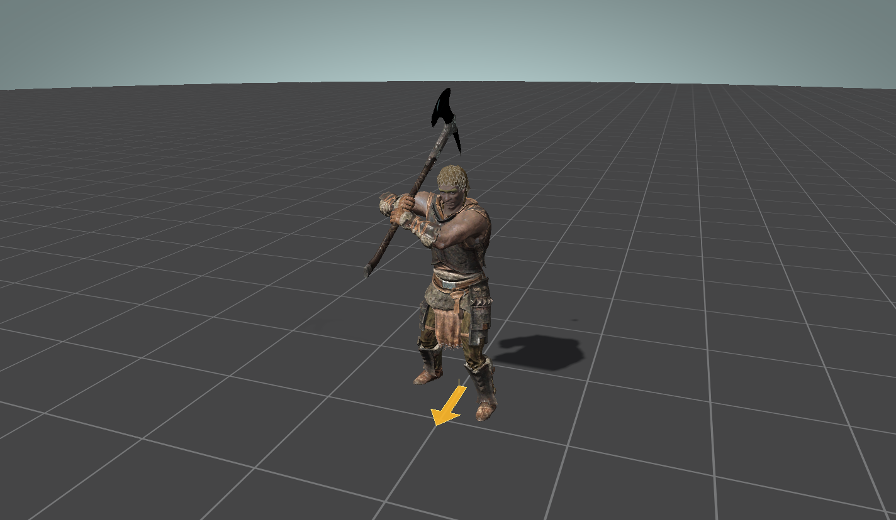

# Playback and timeline

[Back to the README](../README.md)

## Transport

The timeline under the viewport is a tall bar with a large scrubber. Click anywhere on it to jump there. Hold the button to scrub. Playback pauses while you hold and resumes when you let go.

| Control | What it does |
|---|---|
| Play / pause, or Space | Starts and stops playback. Space does nothing while a text box or drop-down has focus. |
| Stop | Returns to the start |
| Arrow buttons | Step one frame back or forward |
| **Loop** | Repeats the clip. On by default. |
| **Step FPS** | Frame rate used for stepping and the frame counter. 30 by default. |
| **Speed** | Your own playback rate, on top of any speed the clip sets |
| **Snap to frame** | Holds the pose on whole frames while scrubbing and playing |

With the timeline focused, Left and Right nudge by half a percent, Page Up and Page Down by a tenth, Home and End jump to the ends.

The readout beside the controls shows the time, the frame number and the clip name. Frame 0 is the first pose.

Playback runs on elapsed time, so changing Step FPS does not change how fast the clip plays. Rendering is capped at 60 frames per second.

## Root motion

Skyrim attack and dodge clips usually carry their travel in AMR `animmotion` and `animrotation` annotations. With **Root motion** ticked the previewer applies them, so the actor moves and turns as in game. Untick it to watch the clip in place.

A small amber arrow lies on the floor at the actor root. Its base is the point root motion moves, and it points along the actor's facing.

Clips with no AMR annotations stay in place. The previewer does not extract root motion from the root bone's own animation.

## Follow camera

**Follow scene** keeps the camera travelling with the actor root. The view keeps its angle, distance and offset and moves by however far the root moves, so a long dodge stays in frame without the camera re-fitting or zooming.

You can orbit, pan and zoom while it is on. The camera carries on following from wherever you put it. Click the viewport and press F to re-frame.

The drop-down at the bottom of the CAMERA group chooses what F and the first fit aim at. Its entries are Frame whole scene, Frame character (the default) and Frame effects.

## Attack speed

MCO binds the playback speed of every attack clip to the `MCO_AttackSpeed` graph variable, and each `PIE.@SGVF|MCO_AttackSpeed|value` annotation sets it. The previewer does the same. Each annotation's speed runs from its time until the next one, so a clip that goes 1.10x, 1.30x, 1.10x plays each stretch at its own rate.

BFCO clips follow BFCO's rule instead: they play at `BFCO_AttackSpeed`, or at `MCO_AttackSpeed` while that is exactly 1. See [BFCO clips](bfco.md).

Annotations, root motion, sounds, Precision collisions and effects all follow that timing. The note beside the Speed box lists the first four changes and counts the rest, and the readout shows the clip time and current rate.

## Sounds

Tick **Sounds** to hear the clip's `SoundPlay.<EditorID>` annotations as playback passes them. Scrubbing and stepping stay silent.

The previewer looks the editor ID up the way the game does: a sound descriptor with that ID, or a sound marker that points to one. A file is picked at random from the descriptor's list. Volume comes from the descriptor's static attenuation and its category chain, and pitch from its frequency shift and variance. `.wav`, `.xwm` and `.fuz` files all play.

Sounds play centred. Distance attenuation, your in-game volume sliders, conditions and looping are not modelled.

If a sound's editor ID is not defined by any loaded plugin, the **Warnings** tab says so. When your mod folders sit in an MO2 `mods` directory, the previewer also searches the neighbouring folders and names the plugin and mod that has the sound, so you know what to mount.

## Weapon draw and sheathe

When a clip carries `weaponDraw` or `weaponSheathe`, the weapon moves between its holster node and the hand on that frame. An equip clip starts on the holster. An unequip clip starts in the hand.

For any other clip, **Sheathed on holster node** puts the weapon on the holster for its type (`WeaponSword`, `WeaponBack`, `WeaponAxe` and so on).
